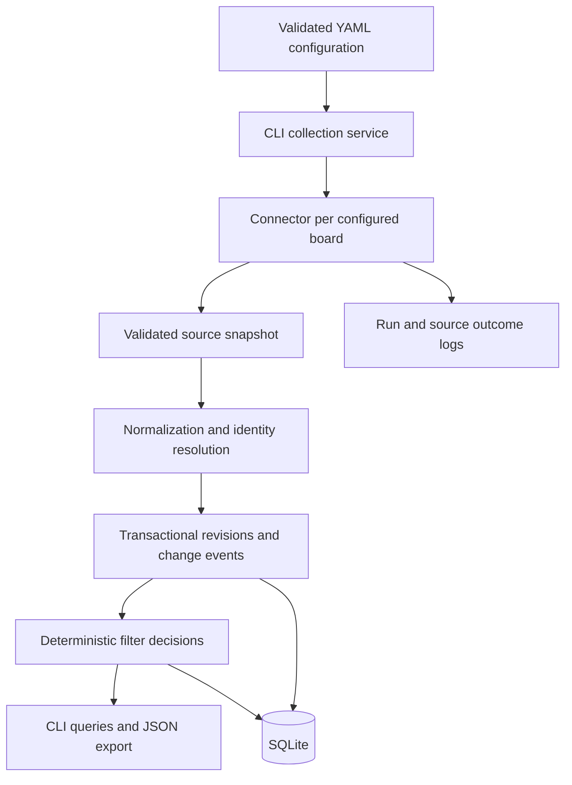

# Architecture proposal

Phase 1 architecture and dependencies were approved on 2026-11-25. Milestones 1.1-1.6 and 2.1a/b are merged. The optional Ollama dependency set was approved on 2026-11-27. Offline HTTP-contract validation is complemented by one successful short synthetic local case on 2026-11-28, with unsuccessful trials recorded separately. General model quality and later intelligent services remain to be validated or implemented.

## 1. Design and scope

Phase 2.1c is also merged. Increment 2.2a adds reviewed eligibility as a deterministic read-only service, without new dependencies or a database migration.

Use a modular monolith: one Python package, one CLI process, one local SQLite database, and explicit interfaces at external boundaries. Ordinary functions and small services orchestrate Phase 1. Preserve these functions when adding LangGraph later; do not build a custom agent framework now.



All collection is independent of candidate preferences. Store postings before filtering, so revised preferences can re-evaluate existing data without refetching or losing previously rejected roles. Job lifecycle status, filter decision, future eligibility, and future application status are separate concepts.

## 2. Minimal package layout

Create directories only when their milestone needs them:

```text
conf/                         # example profile, sources, settings
src/career_intelligence/
    cli.py                    # argparse entry point
    config.py                 # safe YAML loading and validation
    schemas/                  # posting, snapshot, event, profile contracts
    connectors/               # protocol, HTTP policy, Greenhouse adapter
    processing/               # normalization, identity, changes, filters
    storage/                  # SQLAlchemy models and repositories
    workflows/collect.py      # deterministic application service
tests/
    unit/
    integration/
    fixtures/
docs/                         # operational notes when implementation begins
```

Future modules such as `llm/`, `eligibility/`, `matching/`, `notifications/`, and `evaluation/` are added when used. Avoid empty abstractions for every possible SaaS feature.

## 3. Boundary contracts

### Configuration

Separate candidate facts and preferences from source and runtime settings. Validate types, nonnegative limits, supported providers, date precision, unique source keys, and URLs before collection begins. Resolve relative paths against the settings file directory. Reject unknown configuration keys to catch typos. Never interpolate secrets into logged configuration.

Implemented in 1.1: a bounded safe YAML loader rejects aliases, duplicate/non-string keys and custom tags; Pydantic validates settings, linked profile and watchlist files. ISO date text retains year/month/day precision. CLI diagnostics omit input values and raw YAML. Validation performs no network calls or database creation. The build uses `uv_build` with a pinned uv toolchain and hashed dependency lock; Python 3.12 is the initially tested compatibility range.

Source entries contain `company_key`, display name, provider, board token, enabled flag, and optional verified official careers URL. Preserve the requested company groups in the initial watchlist, but do not guess board tokens or claim every company uses Greenhouse. Discovery beyond the watchlist becomes a separate authorized connector in a later phase.

### Connector

Use a Python protocol conceptually equivalent to:

```text
collect(source, limits) -> CollectionSnapshot
CollectionSnapshot:
    source_key, scope_key, started_at, completed_at
    records, expected_total, observed_total
    status: complete | partial | failed
    completeness_evidence, errors
```

The connector handles transport and source-specific decoding. Normalization maps source data to domain schemas. A fixture connector returns the same snapshot contract offline. Each board is a failure boundary: a failed board must not roll back another board's committed result.

One reusable HTTP policy supplies explicit timeouts, request limits, response-size limits, conservative per-host pacing, and bounded retries with jitter. Proposed defaults: 5-second connect timeout, 20-second read timeout, three total attempts, one concurrent request per host, a 10 MiB response limit, 60-second maximum retry wait, and a 5-minute run deadline. All are configurable and unvalidated against real board sizes. Honor `Retry-After`; if it exceeds remaining limits, defer the source instead of retrying early. Retry transport failures, 429, and selected 5xx responses; treat other 4xx responses as source failures. Test time and backoff with injected clocks and sleepers.

Where an API supports pagination, exhaust its documented mechanism within the limits and validate completion. Exceeding page, item, time, or response limits makes a snapshot partial. Invalid required records also make it partial. Valid positive observations may still be saved; partial snapshots never supply negative evidence of removal.

### Initial API choice and validation

Propose Greenhouse's public Job Board API. Its documented list route is `GET https://boards-api.greenhouse.io/v1/boards/{board_token}/jobs?content=true`; GET requests need no authentication. The list includes post `id`, `internal_job_id`, `absolute_url`, and `updated_at`; the two IDs represent different identities. Rate limiting is possible. The documented list response includes `jobs` and `meta.total`, without a documented pagination parameter. Verify count consistency and actual board behavior rather than borrowing Harvest pagination. [Official Greenhouse contract](https://docs.greenhouse.io/job-board.html).

The connector issues one list GET per attempt against the documented API host and processes boards sequentially. It compares `meta.total` to the number of returned rows before filtering prospect posts. Missing totals, duplicate post IDs, invalid rows and item truncation produce partial snapshots. An unreadable or oversized body produces a failed snapshot. A valid empty response can be transport-complete. Reconciliation will still need to treat unexpected empty results as anomalies in milestone 1.4.

On 2026-11-25, a single unauthenticated GET for Datadog's public Greenhouse board returned 391 of 391 rows, all normalized successfully. The public board resolves to the employer's careers site. The smoke check used only the documented GET endpoint, retained aggregate counts, and left Datadog disabled in the shipped watchlist. Employer site terms limit content reuse. Review the relevant terms and intended use before enabling recurring collection or retaining and redistributing employer content. Empty-board behavior was tested with a synthetic fixture. Regional hosts remain outside the tested scope. [Datadog careers](https://careers.datadoghq.com/), [public board](https://job-boards.greenhouse.io/datadog), [Datadog site terms](https://www.datadoghq.com/legal/terms/).

### Normalized posting

Pydantic defines one extensible public schema. Required identity comes from the adapter; other fields remain null when unavailable. Empty lists mean an explicitly empty set, while null means unreported. A date with unknown time keeps its precision; use UTC for internal observation timestamps.

| Group | Fields |
| --- | --- |
| Identity | internal job ID, company key/name, source provider, source board/scope, source post ID, canonical URL, source URL, official application URL |
| Role | title, location text and optional structured locations, remote policy, employment type, seniority |
| Timing | publication date, source update timestamp, first seen, last seen, application deadline, expected start date |
| Content | description text, responsibilities, required and preferred qualifications, required experience, technical skills, academic requirements, language requirements, work authorization |
| Compensation | salary range, currency, pay period, compensation type, optional components, provenance, source reference/date, confidence |
| Lifecycle | source-observation status, current revision ID, fingerprint and normalization version |

Keep source HTML/raw JSON separately with acquisition time and payload hash. Derive plain text using bounded decoding and HTML parsing; preserve paragraph boundaries and do not render active HTML. Source fields map directly where supported; Phase 1 leaves description-derived structured facts unknown unless an explicit, tested source mapping exists. Do not equate `updated_at`, publication date, and first-seen time. Map an official application URL only from attributable source data.

Every interpreted fact later adds evidence: revision ID, source field or exact description span, extraction method, and confidence. Candidate facts similarly reference profile fields. A structured extraction cannot silently overwrite source facts.

## 4. Persistence, identity, and changes

Milestone 1.3 uses SQLAlchemy Core tables in `storage.py`. Initial schema version 1 is created transactionally on an empty database. Source snapshots and raw evidence are retained with a content key for replay detection. A cross-platform OS file lock spans the persistent collection operation. Reads use SQLite's read-only mode. Unexpectedly interrupted collection runs are marked on the next writer startup.

Implemented tables cover collection runs, source outcomes, jobs, source aliases, immutable revisions and reviewable identity collisions. Migration 2 adds change events, source presence and reconciliation scope state. Filter decisions follow in milestone 1.5. Stored timestamps use UTC ISO text. A deterministic versioned SHA-256 fingerprint excludes observation metadata and source identity, preserves meaningful content, and sorts explicitly unordered requirement lists.

Start with these tables, with schema versioning from the first migration:

| Table | Purpose and important constraint |
| --- | --- |
| `collection_runs` | Start/end, configuration version/hash, status, counts, timing |
| `source_runs` | Board/scope result, completeness, errors, counts; belongs to a collection run |
| `jobs` | Stable internal UUID, company, latest revision, first/last seen, lifecycle observation |
| `source_postings` | Alias to a job; unique `(provider, board_scope, source_post_id)`, canonical URL, source-specific presence history |
| `job_revisions` | Immutable normalized payload and raw evidence; unique `(job_id, revision_number)` |
| `change_events` | Ordered transitions with changed field paths; unique deterministic event key |
| `filter_decisions` | Job revision, profile/filter configuration version, keep/review/exclude, evidence and reason codes |
| `schema_version` | Ordered schema upgrades, with refusal of newer unsupported schemas |

Small numbered SQLAlchemy migration functions are sufficient initially. Once persisted schemas evolve beyond simple additions, review a migration framework rather than growing an ad hoc one. Do not rely on `create_all` to upgrade an existing database.

Use a transaction per source ingestion: observations, revisions, events, and successful reconciliation commit together. An interrupted transaction must be safe to replay. Persist failure outcomes in a separate transaction after rollback. Refuse concurrent writers using a tested run lock; a second process fails clearly without changing data. Configure foreign keys and transaction behavior explicitly. SQLite driver transaction behavior needs care and integration tests, as described in the [SQLAlchemy SQLite documentation](https://docs.sqlalchemy.org/en/20/dialects/sqlite.html). SQLAlchemy provides a future database seam, not a promise of effortless PostgreSQL migration.

Identity rules, in order:

1. Match the exact provider, board/scope, and source post ID.
2. With consistent company identity, an exact canonical posting URL can attach another source alias. If identity evidence conflicts, keep separate records and record a reviewable collision.
3. A content fingerprint can identify identical revisions and flag duplicate candidates; **content similarity alone never merges distinct vacancies**.

URL canonicalization lowercases scheme/host, removes fragments and explicitly recognized tracking parameters, and preserves identifying query parameters such as `gh_jid`. Do not follow arbitrary links or remove all query strings.

Fingerprint versioned, canonical JSON of meaningful normalized fields using SHA-256. Include title, locations, description, eligibility, dates, and compensation when present; exclude collection timestamps, ordering noise, and provider update timestamps alone. Sort only semantically unordered collections. Preserve meaningful text and numerical changes. On A -> B -> A content changes, create a new revision for each transition; historical content hashes are not globally unique revision identifiers.

### Lifecycle rules

Milestone 1.4 persists these transitions in the source transaction. Event uniqueness and snapshot replay detection prevent repeated delivery candidates. Scope state is keyed by source key and provider scope. Policy changes reset omission evidence. A later distinct complete poll with identical IDs confirms an empty/depleted snapshot, after which normal absence counting applies. Partial/failed polls also clear anomaly confirmation. Availability is aggregated over source aliases, while historical payloads remain immutable. Migration from schema 1 preserves data and establishes presence on subsequent observations.

- First observation: `new` event; say **newly discovered**, not necessarily newly published.
- Meaningful fingerprint change: new revision and `updated` event containing field differences. Unchanged polls only refresh last-seen observations.
- One complete, matching-scope snapshot omits a posting: `missing` observation; keep history and show availability uncertainty.
- Proposed conservative removal policy: two consecutive complete omissions spanning at least 24 hours produce `removed_from_source`. Partial/failed runs do not advance or satisfy this rule; they break the consecutive-omission streak. An empty or unexpectedly depleted board requires an additional independent validation before it can contribute removal evidence. The anomaly threshold is configurable and must be calibrated.
- `removed_from_source` is an observed source condition, not a claim that the employer filled or closed the vacancy. An explicit attributable closing status or unambiguous expired deadline is stored separately with its evidence.
- Reappearance after removal produces `reopened`; return after a single missing observation produces `returned`. Keep the same identity and emit a transition even if the content is unchanged.
- Disabling/removing a source, changing its scope, a timeout, a 404 board, malformed data, or reaching a budget limit never closes jobs.
- A job linked to multiple sources stays available if any source confirms it present. Removal from one alias must not remove the entire opportunity.

Event keys include stable job/source identity, transition/revision sequence, and event type. Replay cannot recreate the same committed transition. Later notifications use a transactional outbox keyed by event, candidate, channel, and delivery kind; external delivery is at-least-once with deduplication, not an unsupported exactly-once guarantee.

## 5. Deterministic filtering

Milestone 1.5 implements pure rule evaluation in `filtering.py` and persists results separately in the migration 3 `filter_decisions` table. Its key contains job ID, immutable revision number and a hash of the profile, filter policy and evaluator version. Refiltering changes decision records without altering source observations, job revisions or change events.

Role/location matching uses word sequences, configured alias groups and exact evidence spans. Unknown or ambiguous facts route to review. Configured title seniorities and attributable comparable annual total compensation can exclude. Comprehensive eligibility interpretation stays in Phase 2. Listing joins decisions for the current configuration, applies decision selection before pagination and orders known locations by profile preference. Table rendering removes control characters from external content.

Return `keep`, `review`, or `exclude`, with reason codes, matched text, and configuration version. These are discovery decisions, not full eligibility assessments or hiring probabilities.

Use configured role aliases for the target AI/ML, software, infrastructure, applied research, and quantitative roles. Explicit incompatible seniority in the title can exclude; absence of a junior label must not. Favor known preferred locations using aliases without inventing remote work authorization. Unknown or ambiguous role, location, experience, and seniority route to review. The optional pay filter applies only to explicitly comparable disclosed annual total compensation; base salary alone cannot establish that total compensation is too low. No currency conversion without a dated authorized FX source. Default uncertain and undisclosed compensation to review/retain.

Phase 1 does not parse every eligibility requirement from prose. It will expose the description and leave those assessments pending Phase 2. Filter changes invalidate only decisions, not job revisions.

## 6. Later intelligent workflow

Implemented in 2.1a: `extraction.py` defines a strict quoted-fact schema, a small async provider protocol, bounded local response replay and a validation service. `jobs extract` selects an immutable revision read-only and returns a separate versioned result; it does not mutate or persist source facts. Only title, location and description enter the provider request. Exact Unicode spans, finite confidence values, collection bounds and explicit-empty evidence are validated. Oversized, malformed, timed-out or unsupported responses produce safe failure statuses, with no retries. This validates textual presence, not semantic entailment. See [the extraction contract](docs/EXTRACTION.md). No database migration or dependency addition is needed for this increment.

The local smoke-validation increment adds prompt v2 with bounded, deterministic span hints derived from those same source fields. This helps a model select exact positions while preserving the original evidence validator: no approximate matches or offset repairs are accepted. Hints and original fields share the configured input-byte budget. The explicit `scripts/smoke_ollama.py --live` path uses a fixed synthetic fixture, disposable SQLite and one bounded provider attempt; its summary contains only checks and safe HTTP timing diagnostics. It never loads a private settings/profile file or existing database. Default tests use mock providers for that script and CI does not invoke inference.

Implemented in 2.1b: a lazily imported LangChain/Ollama adapter, explicitly selected with `--ollama`, uses only a validated loopback IP endpoint. A bounded `/api/show` preflight must identify a local completion model before `/api/chat` receives posting text. Native schema steering preserves raw JSON for the existing validator; tool calls and incomplete generation are refused. HTTP response bytes, timeout, output tokens and context are bounded/configured, with no retries, proxy inheritance, redirects or tracing. A clean task context isolates ambient callbacks; inherited authorization is stripped. SDK clients close on success, failure and cancellation. The pinned integration's private client references are a small documented compatibility boundary. Default installation and deterministic services do not import LangChain. Model/hardware compatibility and semantic extraction quality require a separately authorized live check.

Optional OpenAI remains planned. Local inference needs no OpenAI key. No tools are exposed to a model processing job descriptions. Output can only contribute validated quoted interpretations; it cannot access secrets, execute code, or modify candidate facts. A source quote proves textual presence, not semantic correctness or prompt-injection resistance.

Implemented in 2.2a: `eligibility.py` evaluates bounded, typed requirements supplied through a local review document. Review provenance, job ID/revision/fingerprint, profile hash and exact source evidence are required; model extraction output cannot be used directly as a review. `jobs eligibility --template` emits an unreviewed skeleton and evaluation requires an explicit as-of date. Calendar bounds, merged experience intervals, explicit apprenticeship policy, literal degrees/proficiency scales, declared authorization and separately attested feasible locations produce rule-level outcomes. Missing or unmapped facts remain unknown. Confirmed mandatory contradictions can produce scoped `not_eligible`; preferred gaps remain potential. Eligibility never mutates source/filter/application state. Output includes review/assessment hashes and unassessed rule families. See [the eligibility guide](docs/ELIGIBILITY.md).

The current education model describes expected graduation, not verified completion; degree/compatible graduation findings therefore remain potential. Completeness assertions and feasible locations are reviewed local configuration, bound to the profile snapshot. There is no immigration-law inference, automatic semantic requirement normalization, compound-OR evaluator or global hiring-eligibility guarantee. Further 2.2 work must preserve that trust boundary instead of promoting exact LLM quotations into confirmed requirements.

Evaluate technical skills, professional experience, academics, seniority, domain, location, compensation, career objectives, and entrepreneurial learning separately. Versioned rubrics produce bounded dimension scores with evidence, confidence, strengths, gaps, blockers, transferable skills, and recommendations. A deterministic function computes `sum(weight * dimension_score) / sum(weight)` for assessed dimensions; report weight coverage and withhold a final score below a configured coverage minimum. Keep missing dimensions visibly unknown. Scores measure configured fit, not hiring probability. Deadline/eligibility rules can change recommendation priority independently of fit.

Separate employer-disclosed base, bonus, equity, signing bonus, and total compensation; external benchmarks and estimates carry their own provenance, date, currency, confidence, and annualization assumptions. No invented salary or silent substitution of a benchmark for employer pay.

Phase 3 wraps application services in LangGraph with branches for unchanged revisions, excluded postings, explicit ineligibility, unavailable models, exhausted budgets, and relevant preparation candidates. LangGraph supplies explicit state/control flow; it is intentionally deferred until these branches exist. [LangGraph overview](https://docs.langchain.com/oss/python/langgraph/overview).

Cache analysis by job revision, candidate fact/preference hash, model, prompt, schema, and rubric versions. Profile/model changes may deliberately reanalyze existing jobs; routine collection only schedules new or materially changed jobs. Enforce call/token/run budgets before each model call; record actual usage and price provenance, leaving cost unknown when rates are unavailable. LLM failure preserves deterministic discovery and reporting.

Preparation covers likely topics, algorithms and referenced exercises, statistics, ML/system design, software engineering, role domain, behavioral practice, candidate projects/CV suggestions, and feasible 2/5/10/20-hour plans. Mark company-specific claims as confirmed only with cited evidence; otherwise label general recommendations. Feedback can personalize future plans, but never promotes practiced skills into verified profile facts automatically.

Phase 4 adds interchangeable notification providers and scheduling. Phase 5 adds Streamlit application tracking, separate from source availability. Phase 6 evaluates the hybrid system against the deterministic baseline before SaaS work.

## 7. Trade-offs and deployment assumptions

Milestone 1.6 adds an offline evaluation module and a standalone script using the existing data contracts. Synthetic annotations, the candidate profile and keyword baseline are versioned with measured output. A separate end-to-end integration test controls the HTTP transport and observation clock while exercising normal CLI entry points. Eligibility accuracy and hybrid comparison remain unevaluated until the Phase 2 components and reviewed labels exist.

Backup/restore uses Python's SQLite backup API under the existing writer lock. Integrity and foreign-key checks run before publication to a new destination. A temporary snapshot is atomically published with a hard link on the destination filesystem, requiring hard-link support. This preserves existing output files and avoids exposing partial backups. Recovery and retention procedures are in [docs/OPERATIONS.md](docs/OPERATIONS.md).

After the initial documentation push, develop every increment on a dedicated branch and submit a PR to `main`. Establish CI in milestone 1.1, alongside the first executable code: locked installation, lint/format checks, offline tests across Windows and Linux, and package-build validation. Extend the checks with each milestone. Delivery automation is introduced with Phase 4 deployment packaging once the release target is defined.

| Choice | Benefit | Limitation / revisit trigger |
| --- | --- | --- |
| One synchronous process | Straightforward debugging and transactions | Add bounded parallelism only after measured collection bottlenecks |
| Greenhouse first | One narrow connector to validate end to end | Does not cover the full watchlist; other ATS adapters are explicit later work |
| SQLite and local run lock | No database service or queue | One writer; multi-user or concurrent workers require PostgreSQL design and tests |
| Standard-library CLI and retries | Small dependency surface | Reconsider richer frameworks only after actual CLI/transport needs emerge |
| Persist revisions and raw evidence | Auditable changes and repeatable evaluation | Storage grows; define retention and purge before sustained collection |
| Conservative unknown handling | Lower risk of silently missing opportunities | More review work; benchmark precision/recall before tightening filters |
| Defer agent frameworks | A reproducible baseline before LLM complexity | No semantic fit or personalized preparation in Phase 1 |
| Single-user domain | Deliver a useful personal tool quickly | SaaS still needs auth, tenant isolation, consent, quotas, retention, and operational security |

Phase 1 targets a local Windows PowerShell workflow and Linux CI. No always-on host is assumed. Later scheduled execution needs a persistent disk, source-compatible outbound access, mutually exclusive runs, backups with a restore test, and explicit Europe/Paris scheduling including daylight-saving behavior. Docker does not itself provide persistence or scheduling. Do not select cloud services, paid APIs, SMTP providers, or model hardware before their constraints are known.

Keep runtime databases, raw payloads, logs, private profiles, CVs, credentials, and caches out of Git from the first implementation milestone. Operational logs contain identifiers, reason codes, counts and timings, not full private profiles or job bodies. Model requests receive the minimum necessary candidate information. Define personal-data retention and commercial data-use permissions before productization.
